

# Kelengo: İngilizce Kelimeler

**İngilizce kelime öğren ve ezberle; sade, anlaşılır ve internetsiz.**

A1'den C2'ye yaklaşık 6.000 kelime · Sesli telaffuz · Testler · 11 dil

[🇹🇷 Türkçe](#türkçe) · [🇬🇧 English](#english)

---

## Türkçe

Başlangıçtan (A1) ileri seviyeye (C2) sıralanmış yaklaşık 6.000 İngilizce kelimeyi her gün birkaç dakikayla öğren. Her İngilizce kelime Türkçe anlamı, örnek cümlesi ve sesli telaffuzuyla birlikte gelir. Uygulama internet olmadan da çalışır.

### Özellikler

| | |
|---|---|
| **Seviye seviye kelime** | A1, A2, B1, B2, C1 ve C2'ye göre sıralanmış 120 seviye; her seviyede 50 kelime. Kaldığın yerden devam et. |
| **Kelime kartları** | Kartı çevir: İngilizcesi ve Türkçe anlamı. Her kelimede örnek cümle ve çevirisi. |
| **Sesli telaffuz** | Kelimeyi ve cümleyi dinle, konuşma hızını ayarla. |
| **Test ve sınav modu** | Kolay, orta, kapsamlı ve özel test; süreli sınav; hangi kelimeyi bilip bilemediğini gösteren ayrıntılı sonuç, test geçmişi ve en iyi skorlar. |
| **Favoriler** | Zorlandığın kelimeleri favorilere ekle, favorilerinle alıştırma testi çöz. |
| **İlerleme** | Öğrendiğin kelime sayısı, tamamlanan seviyeler, ortalama skor ve A1'den C2'ye her seviyedeki ilerleme. |
| **Günlük hatırlatıcı** | Seçtiğin saatte kısa bir hatırlatma ve bazı günler "günün kelimesi" bildirimi. |
| **11 dil** | Türkçe, Almanca, İspanyolca, Portekizce, Fransızca, Rusça, Arapça, Endonezce, Vietnamca, Japonca ve Korece. |
| **İnternetsiz** | Kelimeler, testler ve seslendirme internet olmadan çalışır. |

YDS, YÖKDİL, YDT, IELTS ve TOEFL'a hazırlanırken kelime hazineni geliştirmek, okulda İngilizce derslerine destek olmak ya da yurt dışına çıkmadan önce temel kelimeleri öğrenmek için idealdir.

### Ekran görüntüleri

<table>
  <tr>
    <td></td>
    <td>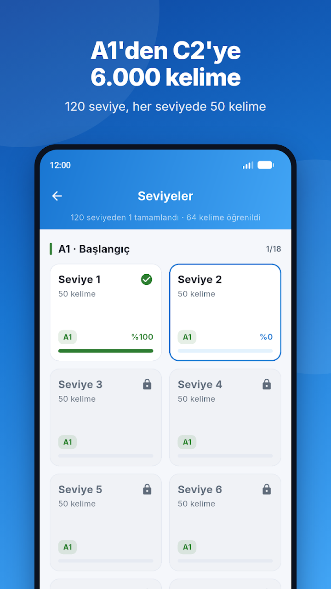</td>
    <td>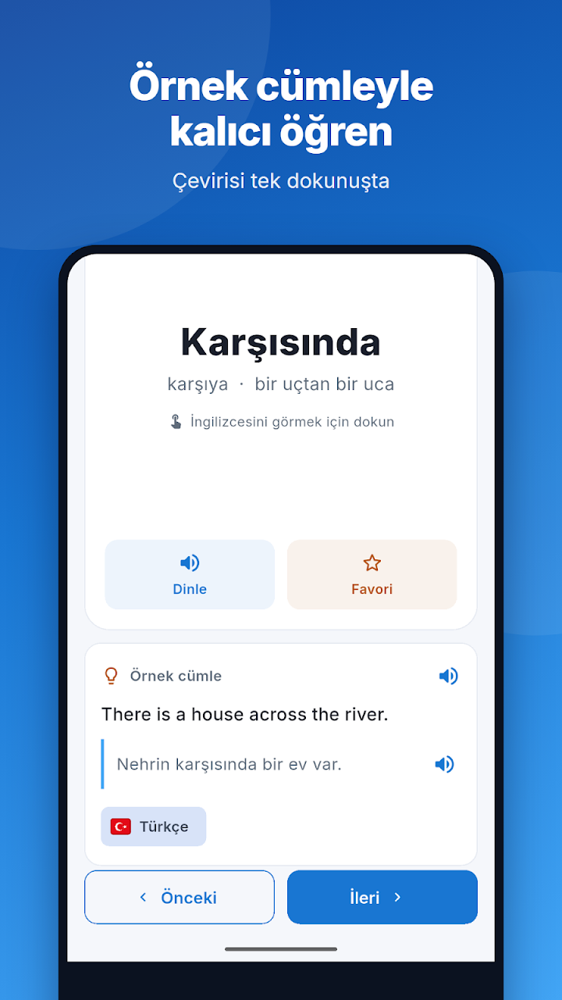</td>
    <td>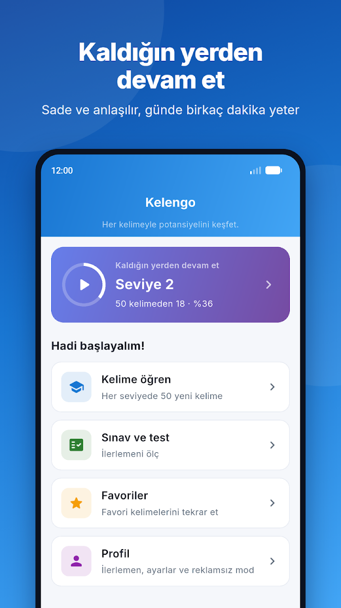</td>
  </tr>
  <tr>
    <td>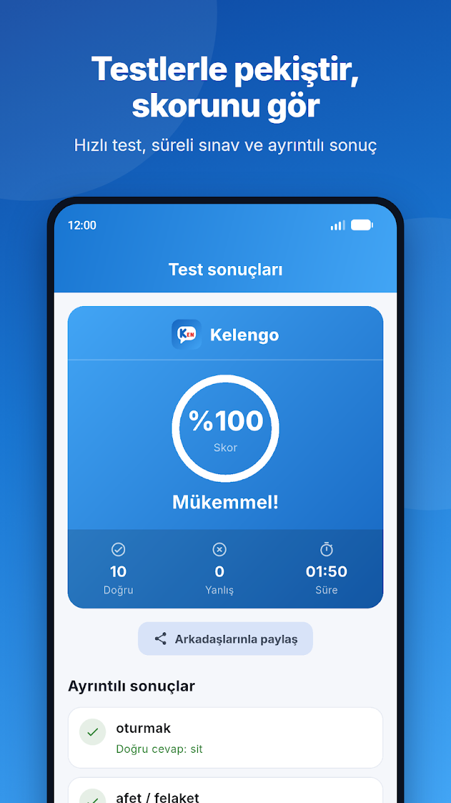</td>
    <td>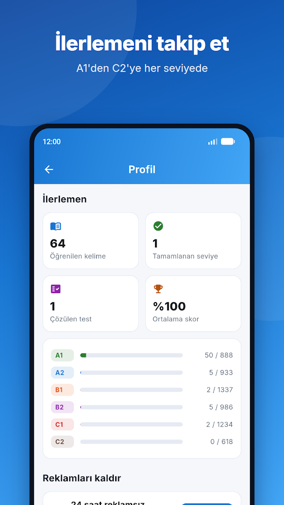</td>
    <td>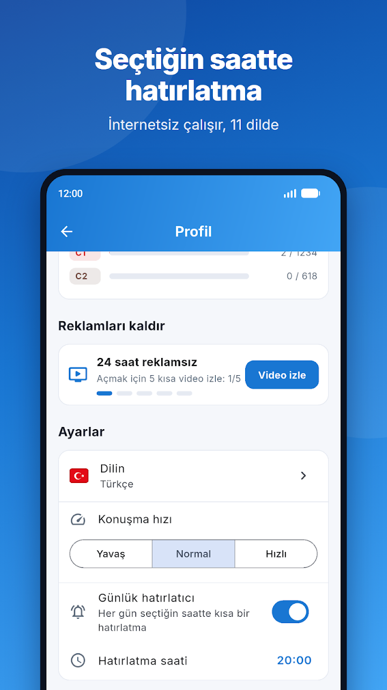</td>
    <td>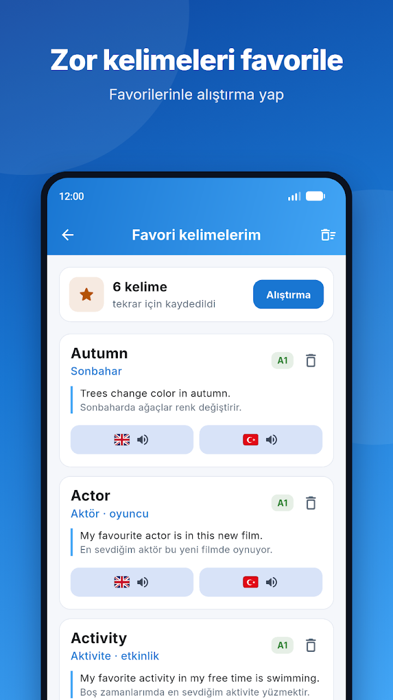</td>
  </tr>
</table>

### İndir

Kelengo ücretsizdir ve reklam içerir. Birkaç kısa video izleyerek 24 saat reklamsız kullanabilirsin.

> Bu repo uygulamanın tanıtım sayfasıdır; uygulamanın kaynak kodu burada yayınlanmamaktadır.

---

## English

Learn about 6,000 English words, ordered from beginner (A1) to advanced (C2), in just a few minutes a day. Every English word comes with the meaning in your language, an example sentence and audio pronunciation. The app works without an internet connection.

### Features

| | |
|---|---|
| **Level by level** | 120 levels ordered by A1, A2, B1, B2, C1 and C2, with 50 words in each. Pick up where you left off. |
| **Word cards** | Flip the card for the English word and its meaning, with an example sentence and its translation for every word. |
| **Audio pronunciation** | Listen to the word and the sentence, and adjust the speech speed. |
| **Quizzes and exam mode** | Easy, medium, exhaustive and custom quizzes; a timed exam mode; detailed results, quiz history and best scores. |
| **Favorites** | Save the words you find hard and practise them in your own quiz. |
| **Progress** | Words learned, levels completed, average score and your progress in every level from A1 to C2. |
| **Daily reminder** | A short reminder at the time you choose and, on some days, a "word of the day". |
| **11 languages** | Turkish, German, Spanish, Portuguese, French, Russian, Arabic, Indonesian, Vietnamese, Japanese and Korean. |
| **Offline** | Words, quizzes and audio work without the internet. |

### Screenshots

<table>
  <tr>
    <td>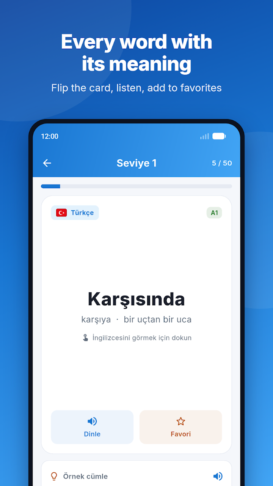</td>
    <td></td>
    <td>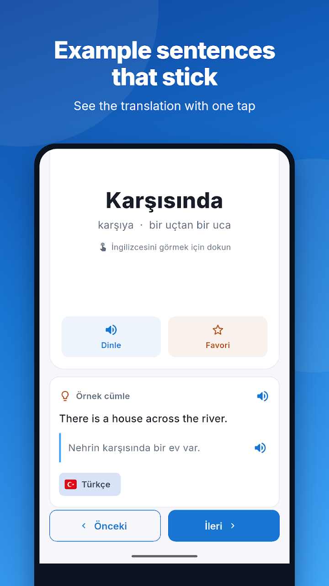</td>
    <td>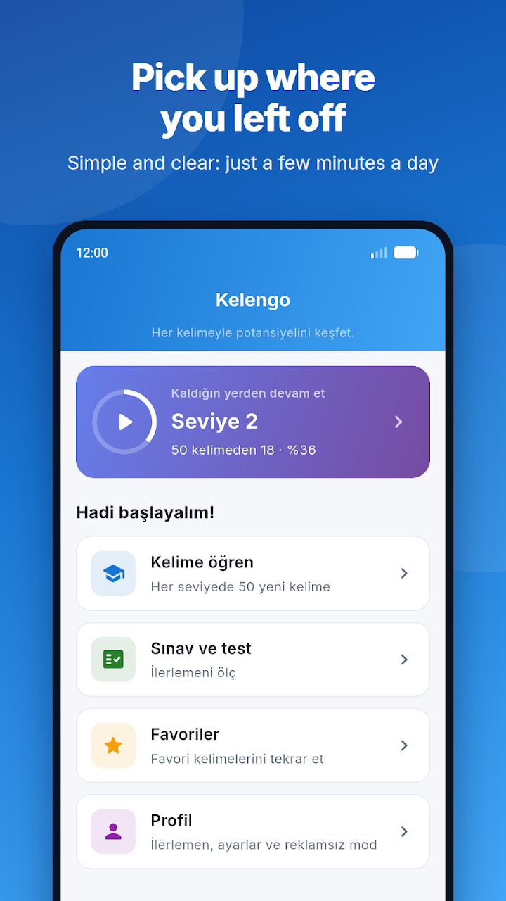</td>
  </tr>
  <tr>
    <td>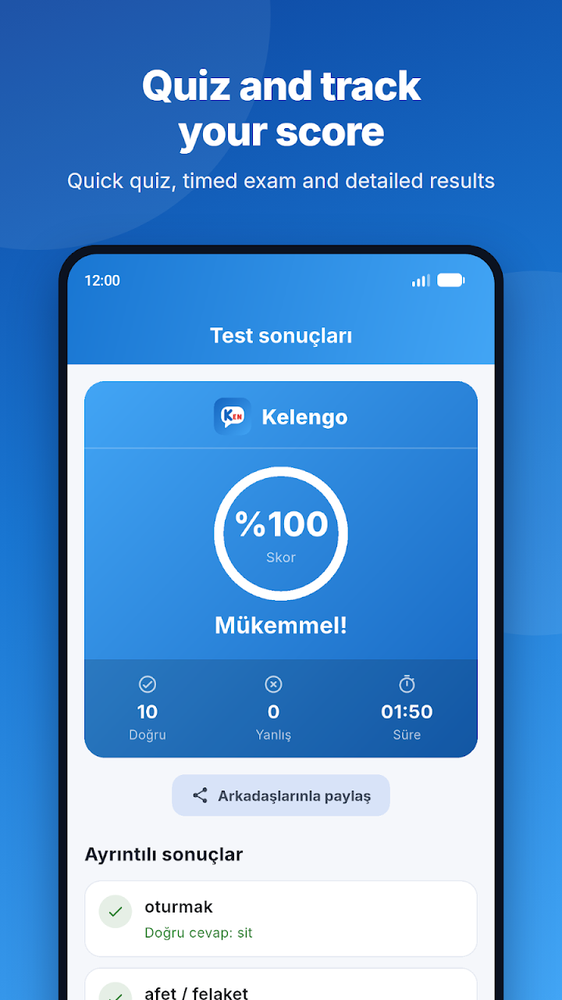</td>
    <td>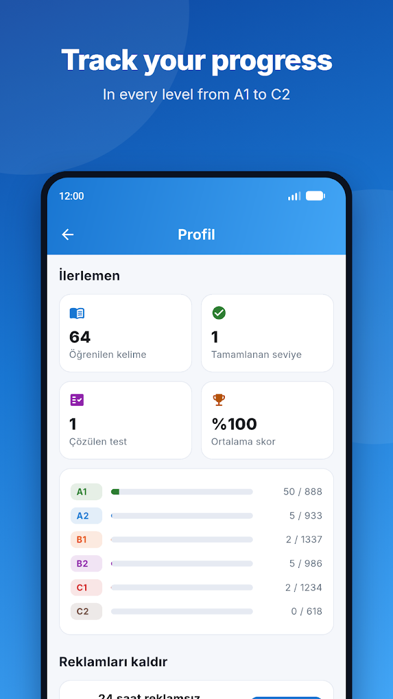</td>
    <td>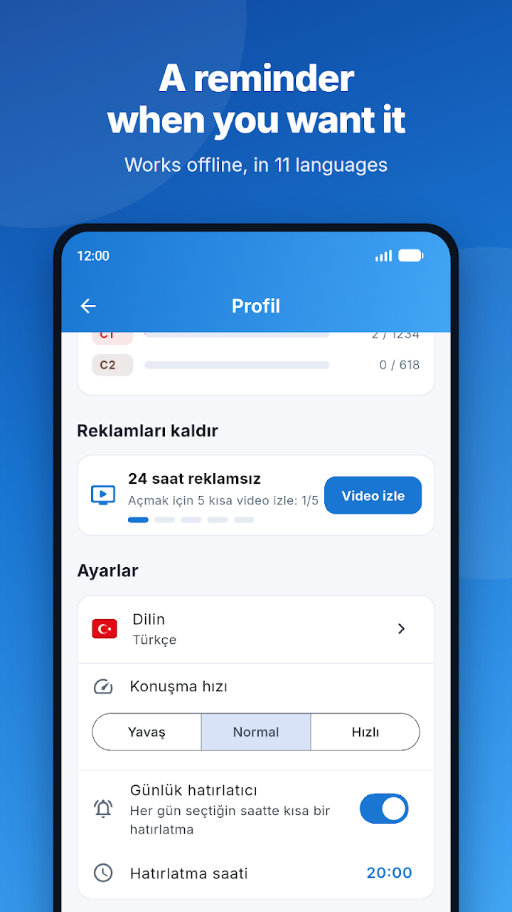</td>
    <td>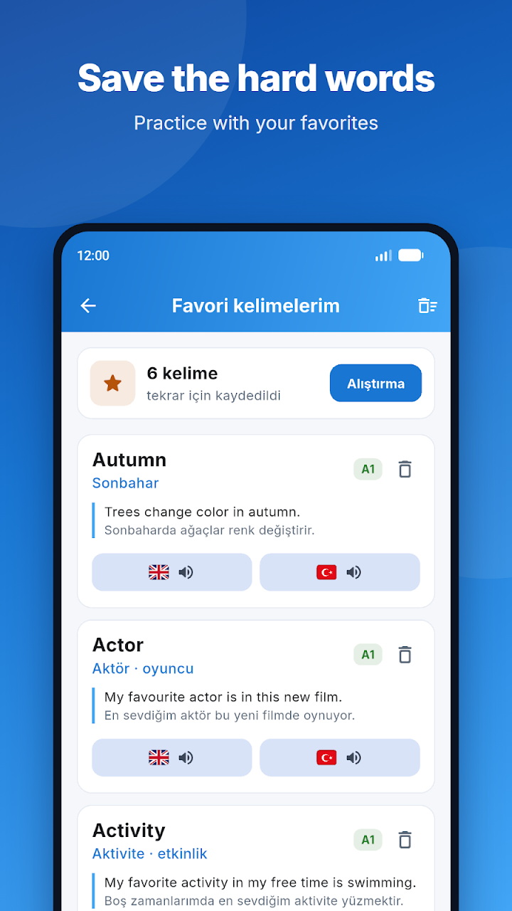</td>
  </tr>
</table>

### Download

Kelengo is free and contains ads. Watch a few short videos to use it ad-free for 24 hours.

> This repository is the app's showcase page; the source code is not published here.

---

Geliştirici / Developer: **Ahmet YILMAZ** · [ahmetyilmazz.github.io](https://ahmetyilmazz.github.io) · [Google Play](https://play.google.com/store/apps/developer?id=Ahmet+YIILMAZ)

